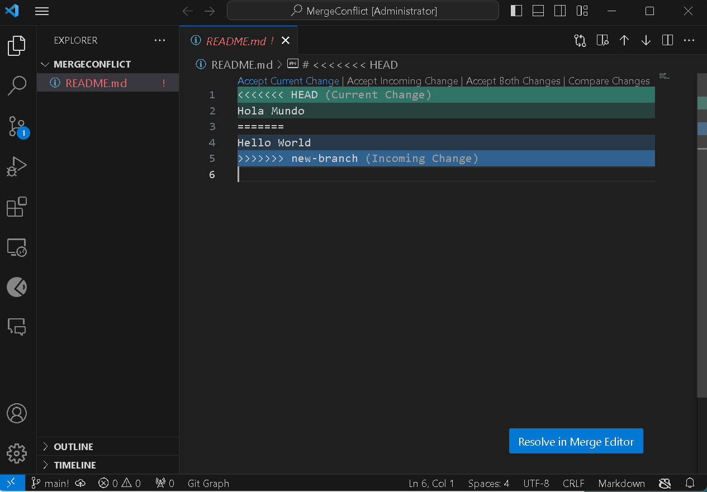
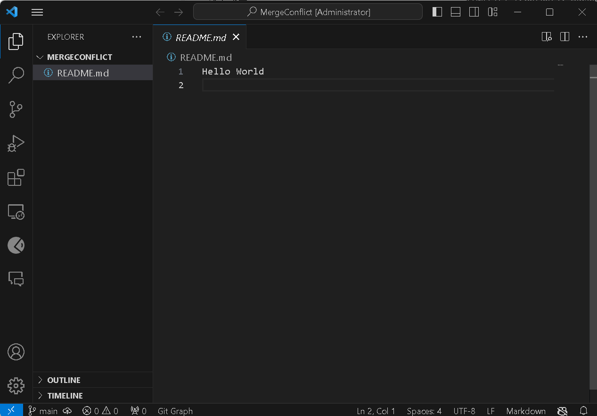

before:

after:

cd "/d/UCL/moudles/term1/research software engineering with python"
mkdir MergeConflict
cd MergeConflict/
git init
touch README.md
echo "Hello" > README.md
git add README.md
git commit -m "first commit on main"
git switch -c new-branch
echo "Hello World" > README.md
git commit -am "first commit on new-branch"
git switch main
echo "Hola Mundo" > README.md
git commit -am "second commit on main: translates it into Spanish"
git merge new-branch

echo "Hello World" > README.md
git add README.md  
将解决冲突后的文件标记为已解决，并暂存它
发生合并冲突后，Git 会把 README.md 标记为 unmerged（尚未解决冲突）。你需要先用 git add README.md 告诉 Git，你已经解决了冲突。
git commit -m "Resolve merge conflict"

issue link: Answers UCL-COMP0233-26-27/RSE-Classwork#5